# HitsCam Themes — WooCommerce HTML Template

WooCommerce শপের জন্য স্ট্যাটিক HTML টেমপ্লেট (Bootstrap 5.3 + jQuery 3.7 + Owl Carousel 2.3)। বাংলা UI, ব্র্যান্ড রং লাল `#e03131` / নেভি / অ্যাম্বার। ডিজাইন ও ফ্রন্টএন্ড লজিক প্রোটোটাইপ হিসেবে তৈরি; পরে WooCommerce থিমে কনভার্ট করার জন্য। বর্তমান ভার্সন: **v1.8.5**।

## স্ক্রিনশট
| হোম (ডেস্কটপ) | হোম (মোবাইল) |
|---|---|
| 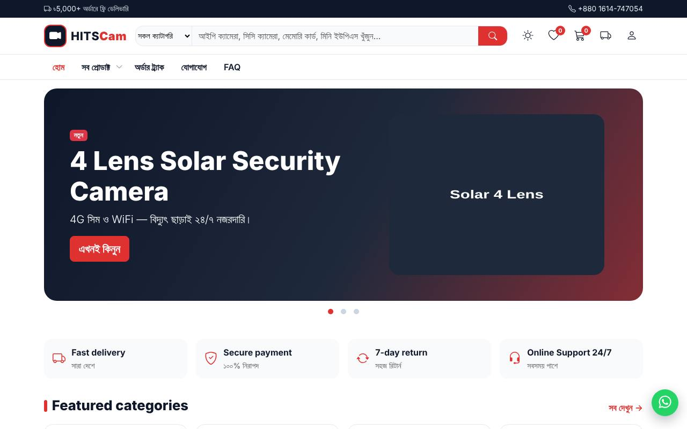 | 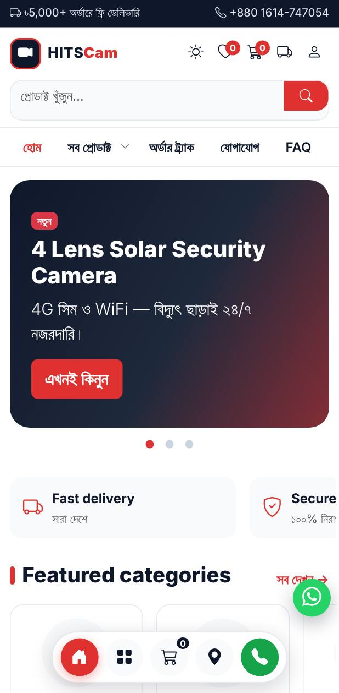 |

| প্রোডাক্ট পেজ — রং × কানেকশন | প্রোডাক্ট পেজ (মোবাইল) |
|---|---|
| 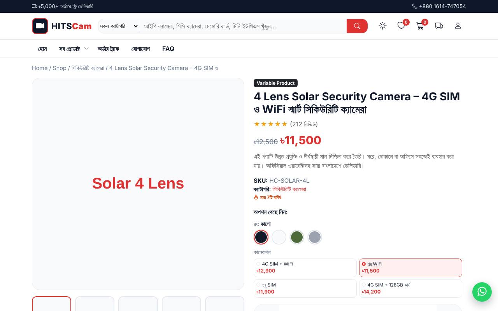 | 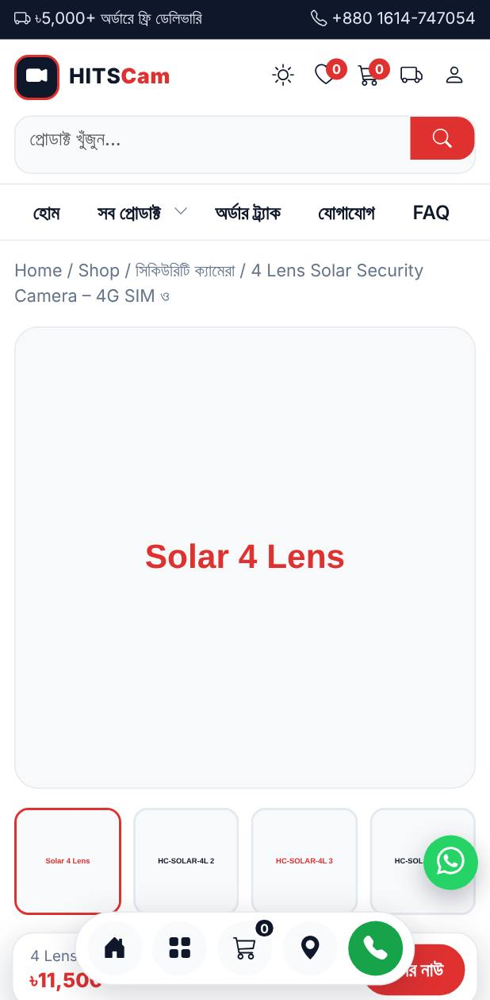 |

| কার্ট — ফ্রি-শিপিং বার, ডেলিভারি ও আস্থা বক্স | কার্ট (মোবাইল) |
|---|---|
| 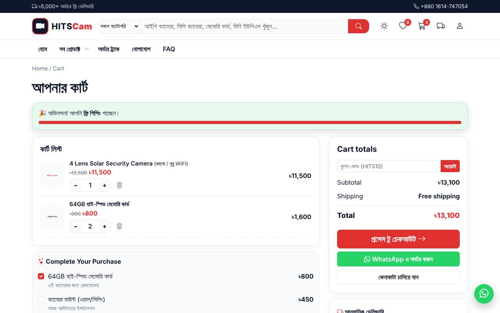 | 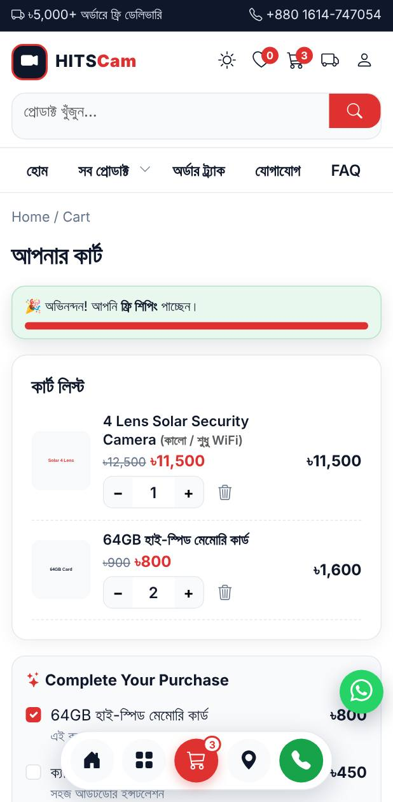 |

| চেকআউট — তিন ঘরের ঠিকানা, ই-মেইল সাজেশন | পণ্য তুলনা |
|---|---|
| 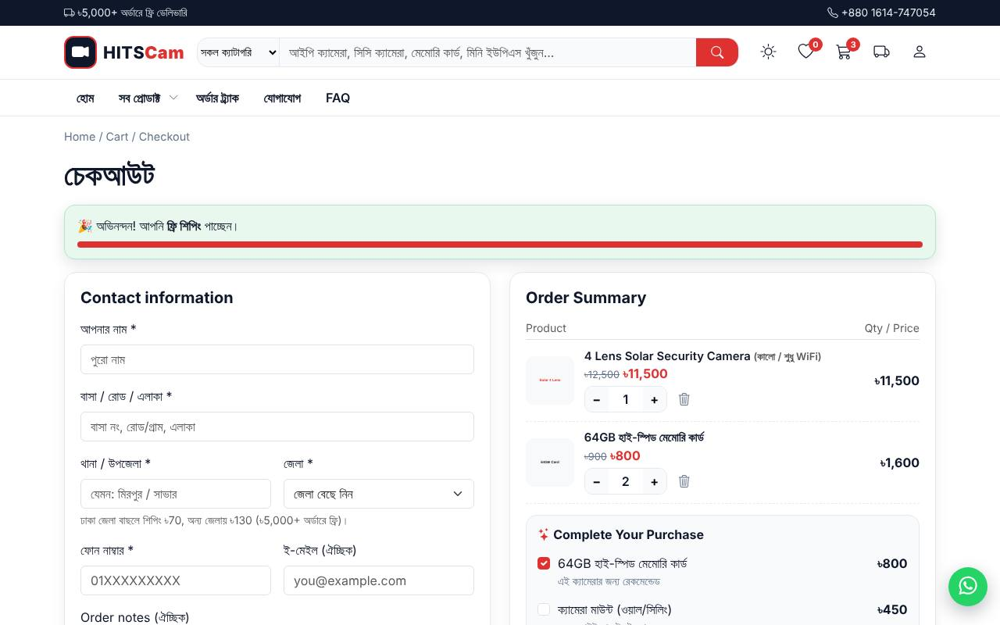 | 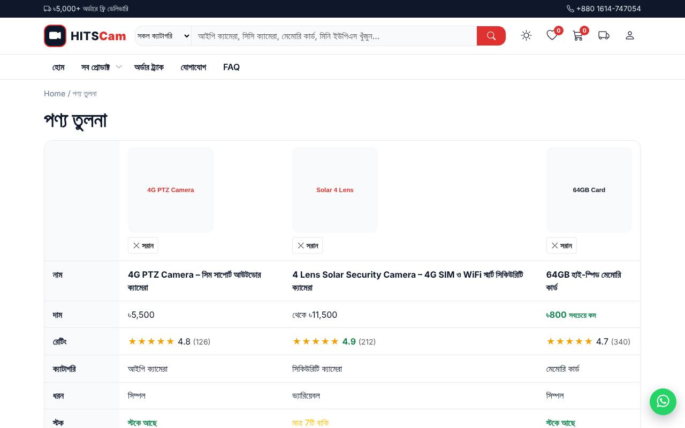 |

| শপ | অর্ডার ট্র্যাক (মোবাইল) | ৪০৪ |
|---|---|---|
| 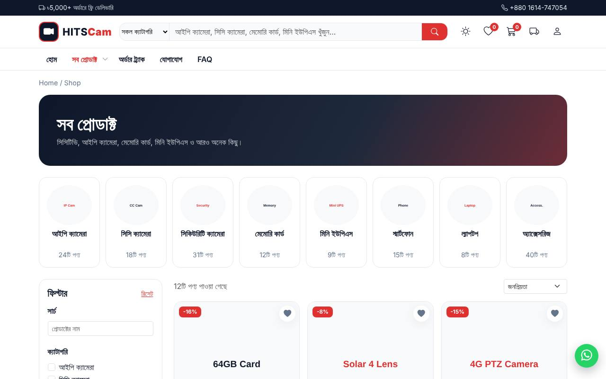 | 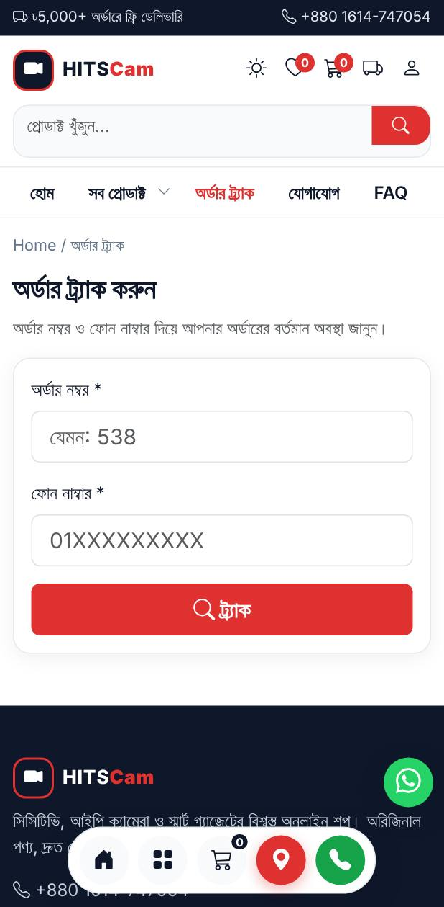 | 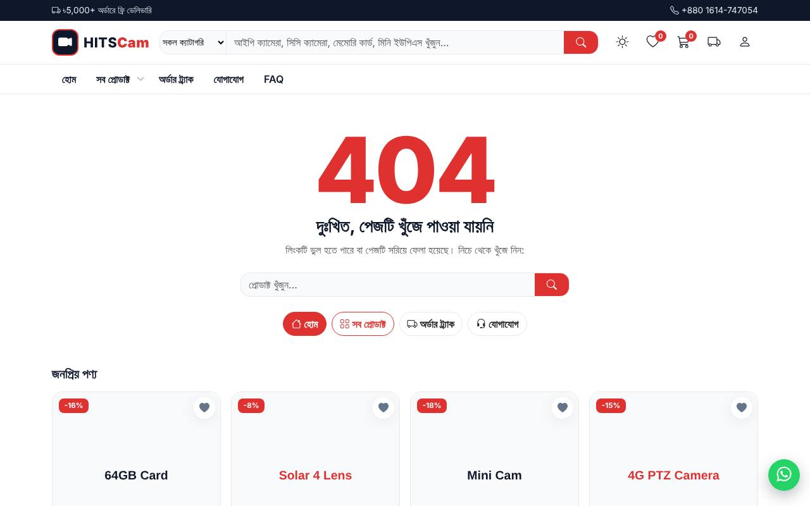 |

> স্ক্রিনশট ডেমো ডাটা ও প্লেসহোল্ডার ছবি দিয়ে তোলা।

## চালানোর নিয়ম
`index.html` ব্রাউজারে খুলুন (Bootstrap, jQuery, Owl Carousel ও ফন্ট CDN থেকে লোড হয়, তাই ইন্টারনেট লাগবে)। PWA/সার্ভিস ওয়ার্কার চেক করতে লোকাল সার্ভার লাগে: `npm ci && npm run serve` → http://127.0.0.1:4173

## ফাইল কাঠামো
| পথ | কাজ |
|---|---|
| `assets/js/app.js` | মূল লজিক `window.HC` (কার্ট, উইশলিস্ট, কম্পেয়ার, চেকআউট, কার্ড রেন্ডার, ড্রাফট, রিমাইন্ডার ইত্যাদি) |
| `assets/js/data.js` | ডেমো ডাটা `window.HC_DATA` (প্রোডাক্ট, ক্যাটাগরি, upsell, `info`/`more` অ্যাট্রিবিউট) |
| `assets/css/style.css` | সব স্টাইল; ব্র্যান্ড রং `:root` এ (`--brand` ইত্যাদি) |
| `manifest.webmanifest`, `sw.js`, `assets/icons/` | PWA |
| `robots.txt`, `sitemap.xml` | SEO |
| `tests/`, `playwright.config.js`, `.github/workflows/` | টেস্ট ও CI |
| `docs/screenshots/` | README এর স্ক্রিনশট |

## পেজ
| ফাইল | বিবরণ |
|---|---|
| `index.html` | হোম: স্লাইডার, Trust row (মোবাইলে অটো-স্লাইড), Featured categories, Trending, Flash sale, Best sellers, New arrivals, রিভিউ, নিউজলেটার |
| `shop.html` | ব্যানার, ক্যাটাগরি লিস্ট, ফিল্টার (মূল্য ও রেটিং রেঞ্জ বার), প্রোডাক্ট লিস্ট |
| `category.html?cat=<slug>` | ব্যানার, টপ সেলিং ২, ফিল্টার, প্রোডাক্ট লিস্ট |
| `product.html?id=<id>` | জুম গ্যালারি, ভ্যারিয়েশন/গ্রুপ/অ্যাফিলিয়েট, ডেলিভারি/EMI, Upsell, রিভিউ, Related |
| `cart.html`, `checkout.html`, `order-received.html`, `track-order.html` | কার্ট থেকে অর্ডার ট্র্যাকিং পর্যন্ত |
| `compare.html` | পণ্য তুলনা টেবিল (সর্বোচ্চ ৩টি; কম দাম/ভালো রেটিং হাইলাইট) |
| `terms.html`, `returns.html`, `shipping.html`, `contact.html`, `faq.html` | তথ্য পেজ (লেখা ড্রাফট) |
| `login.html` | লগইন / নতুন অ্যাকাউন্ট (ডেমো UI) |
| `404.html` | কাস্টম 404 (সার্চ + জনপ্রিয় পণ্য) |
| `minicart.html` | মিনি কার্টের স্ট্যান্ডঅ্যালোন ভার্সন |
| `device-compatibility.html`, `social-compatibility.html` | ব্রাউজার/ডিভাইস/ইন-অ্যাপ ব্রাউজার কম্পেটিবিলিটি |

## ফিচার বিস্তারিত

### প্রোডাক্ট টাইপ ও কার্ড
- **Simple / External:** আইকনসহ Additional info (`info` বা ক্যাটাগরি ডিফল্ট)। External এ কার্ট/অর্ডার বাটনের বদলে বাইরের লিংক।
- **Variable / Grouped:** রেডিও বাটন (৩ কলাম গ্রিড, ৪–৬টি হলে দুই সারি); সবচেয়ে কম দামের অপশন ডিফল্ট সিলেক্টেড।
- **একাধিক অ্যাট্রিবিউট (রং × কানেকশন):** `data.js` এ `attributes` (রং সোয়াচ + কানেকশন রেডিও) ও `variations[].attrs`। কার্ড, কুইক ভিউ ও প্রোডাক্ট পেজে একই UI। রং বা কানেকশন বদলালে দাম ও কার্টের লেবেল (যেমন "সাদা / শুধু WiFi") মেলে; লোয়েস্ট প্রাইস ডিফল্ট; যে কম্বিনেশন নেই সেটা ঝাপসা দেখায় ও বাছলে ওই মানের সবচেয়ে কম দামের কম্বিনেশনে যায়। নমুনা: প্রোডাক্ট #২ (৪ রং × ৪ কানেকশন = ১৪ ভ্যারিয়েশন)।
- **কার্ডের ফাঁকা জায়গা ভরা:** একই সারিতে কার্ডের উচ্চতা সমান; ছোট কার্ডে যতটুকু জায়গা ফাঁকা ততটুকু অতিরিক্ত অ্যাট্রিবিউট (`info` + `more`) আইকনসহ দেখায় (`HC.fillCards`)। সারির উচ্চতা কখনো বাড়ে না; সাইজ বদলালে/কার্টে যোগ করলে আবার হিসাব হয়।
- **বাটন:** Add to cart / Order now (ইন্সট্যান্ট অর্ডার মোডাল: Your details + Order Summary)। কার্টে যোগ করলে "ভিউ কার্ট" বাটন এসে তিনটি বাটন পাশাপাশি।
- **কার্ডে:** মোট বিক্রি রেটিংয়ের পাশে, স্টক ১০ বা কম হলে "মাত্র N টি বাকি!", ০ হলে স্টক আউট (বাটন বন্ধ)।
- **কুইক ভিউ:** 👁 বাটনে মোডাল — ভ্যারিয়েশন, পরিমাণ, অ্যাড টু কার্ট।
- **কম্পেয়ার:** ⇄ বাটন; ভাসমান বার; `compare.html` এ পাশাপাশি টেবিল।

### শপ ফিল্টার (`assets/js/shop.js`)
- **মূল্য (৳):** দুই-হাতলের রেঞ্জ বার (ডাটার সর্বনিম্ন–সর্বোচ্চ দাম থেকে নিজে সীমা ঠিক হয়, ধাপ ৳৫০); হাতল পরস্পর পার হয় না; পাশের সংখ্যা ঘরেও লিখে দেওয়া যায় (দুটো সিঙ্কে থাকে)। নির্বাচিত সীমা লেবেলে দেখায়।
- **রেটিং:** সর্বনিম্ন রেটিংয়ের স্লাইডার (০–৫, ধাপ ০.১); ০ হলে "সব", নাহলে "★ ৪.৬+"।
- সার্চ, ক্যাটাগরি, প্রোডাক্ট টাইপের সঙ্গে একসাথে কাজ করে; "রিসেট" সব ফিরিয়ে আনে। মোবাইলে "ফিল্টার" বাটনে খোলে।
- নিচে **"পণ্য তুলনা"** বাটন (কম্পেয়ারে কয়টি পণ্য বাছা আছে তার সংখ্যাসহ) `compare.html` এ নেয়।

### প্রোডাক্ট পেজ
- জুম গ্যালারি + থাম্ব স্লাইডার; শেয়ার বাটন (Facebook, WhatsApp, Messenger, লিংক কপি)।
- **ডেস্কটপে স্প্লিট-স্ক্রল:** ছবির কলাম স্থির, ডান ইনফো কলাম (অপশন, বাটন, ডেলিভারি, EMI, শেয়ার, Frequently bought together) নিজের ভেতরে স্ক্রল করে। ≥৯৯২px ও উচ্চতা ≥৬২০px হলে; মোবাইল/ছোট উচ্চতায় স্বাভাবিক স্ক্রল।
- **"কার্ট দেখুন" বার:** পণ্য (যেকোনো ভ্যারিয়েশন) কার্টে থাকলে WhatsApp বাটনের নিচে "এই পণ্য কার্টে আছে (N টি) — কার্ট দেখুন →"; কার্ট বদলালে নিজে আপডেট হয়।
- মোবাইলে স্টিকি বাই-বার (একটিই দাম); Trust row পুরো প্রস্থে।
- **ডেলিভারি এস্টিমেট:** "ঢাকার ভিতরে/বাইরে" বাছলে আনুমানিক তারিখ (শুক্রবার বাদ) ও চার্জ; পছন্দ চেকআউটের শিপিং-এ বসে যায়। `HC.ZONES` (ঢাকা ৳70, ১–২ কর্মদিবস; বাইরে ৳130, ২–৪)।
- **EMI:** ৳৫,০০০+ পণ্যে ৩/৬/১২ মাসের কিস্তির টেবিল (`HC.EMI_PLANS`, ন্যূনতম `HC.EMI_MIN`; ডেমো হার)।
- **WhatsApp এ অর্ডার:** নির্বাচিত অপশন, পরিমাণ, মোট ও লিংকসহ মেসেজ। নাম্বার `HC.WA_NUM`।
- **স্টকে এলে জানান:** স্টক আউট পণ্যে ফোন নাম্বার সংগ্রহ (`hc_notify`); WooCommerce এ "Back in stock" প্লাগিন/ওয়েবহুকে যুক্ত করবেন।
- SEO: Product + BreadcrumbList JSON-LD (দাম, স্টক, রেটিং)।

### কার্ট
- ক্রস-সেলস "আপনার পছন্দ হতে পারে": ডেস্কটপে ২×২ খোলা; মোবাইলে ডিফল্টে ভাঁজ করা, "দেখুন" বাটনে খোলে।
- **ফ্রি-শিপিং বার** (কার্ট, চেকআউট ও অর্ডার মোডাল): স্ক্রলে হেডারের নিচে আটকে থাকে ও ব্লিংক করে ("আরও ৳X এর পণ্য … ফ্রি শিপিং!"); ৳৫,০০০ ছুঁলে সবুজ, ব্লিংক বন্ধ। `prefers-reduced-motion` এ ব্লিংক নেই।
- **ডান কলাম:** টোটালের নিচে "ডেলিভারি ও আস্থা" বক্স — ঢাকার ভিতরে/বাইরে বাছলে তারিখ, শিপিং ও টোটাল বদলায়; ৭ দিনের রিটার্ন, অরিজিনাল ওয়ারেন্টি, পেমেন্ট মাধ্যম, হেল্পলাইন। ডেস্কটপে স্ক্রলে আটকে থাকে।
- WhatsApp অর্ডার বাটন (কার্ট ও মিনি কার্ট)। কুপন ডেমো: `HITS10`, `WELCOME100`।
- **ফেলে যাওয়া কার্ট রিমাইন্ডার:** ৩০ মিনিটের বেশি পুরোনো কার্ডে ফিরলে ব্যানার (সেশনে একবার, বন্ধ করা যায়); সময় `window.HC_REMIND_MS`।

### চেকআউট ও অর্ডার
- **ঠিকানা তিন ঘরে** (চেকআউট ও ইন্সট্যান্ট অর্ডার): বাসা/রোড/এলাকা, থানা/উপজেলা, জেলা (৬৪ জেলার ড্রপডাউন)। জেলা বাছলে শিপিং জোন নিজে বদলায়। তিনটিই আবশ্যক।
- **ই-মেইল (ঐচ্ছিক):** ব্রাউজার/অ্যাপ অটোফিল (`autocomplete=email`; নাম/ফোন/ঠিকানাতেও), ই-মেইল কিবোর্ড, gmail/yahoo/outlook/hotmail সাজেশন চিপ, ফরম্যাট যাচাই; লগইন করা ই-মেইল নিজে বসে।
- **ড্রাফট:** লিখতে লিখতেই সেভ; রিলোডে ভরা থাকে; অর্ডারের পর মুছে যায়।
- অর্ডারে `road`, `thana`, `district` আলাদা এবং `address` (একত্রে) সেভ হয় (WooCommerce billing address_1/city/state এ সরাসরি মেলে)।
- বিকাশ/নগদ বাছলে TrxID ও স্লিপ আপলোড।
- Order received: রিকনফার্ম বাটন, গ্রাহকের মোবাইলে SMS (প্রিভিউ; আসল SMS এ গেটওয়ে লাগবে), **ইনভয়েস প্রিন্ট** (প্রিন্টে হেডার/ফুটার/বাটন লুকানো)।
- Track order: বাম→ডান টাইমলাইন (মোবাইলে উপর→নিচ), অর্ডার নং/তারিখ/মোট/পেমেন্ট ও পণ্য তালিকা।

### হেডার, নেভিগেশন ও মোবাইল
- হেডার আইকন: ডার্ক/লাইট, উইশলিস্ট (ডান ড্রয়ার), কার্ট, অর্ডার ট্র্যাক (ট্রাক), ইউজার — মোবাইলেও সব দেখা যায়।
- "সব প্রোডাক্ট" সাবমেনু (ডেস্কটপে হোভার, মোবাইলে ট্যাপ)।
- **লাইভ সার্চ সাজেশন:** ২ অক্ষর লিখলেই ছবি, দাম ও লিংকসহ।
- মোবাইল: কার্ড এক কলাম; Trust row, Featured categories, টপ সেলিং সোয়াইপ/অটো-স্লাইড; Featured category কার্ড সমান সাইজ; নিচে ফিক্সড গোল আইকন মেনু।
- ভাসমান WhatsApp চ্যাট ও ব্যাক-টু-টপ।
- সম্প্রতি দেখা পণ্য (হোম ও প্রোডাক্ট পেজ)।

### সাধারণ
- **ডার্ক/লাইট মোড:** পছন্দ সংরক্ষিত।
- **PWA:** `manifest.webmanifest` + `sw.js` (পেজ network-first, স্ট্যাটিক stale-while-revalidate, অফলাইনে ক্যাশ করা পেজ খোলে); হোম স্ক্রিনে ইনস্টল করা যায়। ক্যাশ বদলাতে `sw.js` এর `VERSION` বাড়ান।
- **SEO:** প্রতি পেজে description, Open Graph, theme-color; হোমে Organization + WebSite (SearchAction) JSON-LD; `robots.txt`, `sitemap.xml`। **ডিপ্লয়ের আগে** `example.com` বদলে আসল ডোমেইন বসান (robots.txt, sitemap.xml, index.html এর JSON-LD)।
- **অ্যাক্সেসিবিলিটি:** স্কিপ লিংক, `:focus-visible` আউটলাইন, মোডালে `aria-labelledby`।
- ইন-অ্যাপ ব্রাউজারে (`localStorage` ব্লক) কার্ট মেমোরি ফলব্যাকে চলে।

## ভার্সন ইতিহাস
| ট্যাগ | কী যোগ হয়েছে |
|---|---|
| v1.0.x | শুরু; Grouped/Variable রেডিও, সবচেয়ে কম দামের অপশন ডিফল্ট |
| v1.1.x | কার্ডে ইনফো আইকন, মোবাইল গোল আইকন ডক, মোট বিক্রি |
| v1.2.0 | বিকাশ/নগদ TrxID ও স্লিপ আপলোড |
| v1.3.x | মোবাইল লেআউট, উইশলিস্ট ড্রয়ার, লগইন, সাবমেনু, ভিউ কার্ট, রিকনফার্ম+SMS, ট্র্যাক অর্ডার |
| v1.4.0 | ডার্ক মোড, লাইভ সার্চ, সম্প্রতি দেখা, স্টক আর্জেন্সি, শেয়ার, স্টিকি বাই-বার, WhatsApp/ব্যাক-টু-টপ |
| v1.5.x | GitHub Actions CI (১০ ডিভাইস/ব্রাউজার), মোবাইল হেডার আইকন, অটো-স্লাইড Trust row, সমান ক্যাটাগরি কার্ড |
| v1.6.0 | কুইক ভিউ, কম্পেয়ার, PWA, SEO/JSON-LD, 404, a11y, ইনভয়েস প্রিন্ট |
| v1.6.1 / v1.6.4 / v1.7.0 | রং × কানেকশন মাল্টি-অ্যাট্রিবিউট; কার্ডে অ্যাট্রিবিউট চিপ |
| v1.7.1 | WhatsApp অর্ডার, ডেলিভারি এস্টিমেট, EMI, চেকআউট ড্রাফট, কার্ট রিমাইন্ডার, স্টকে এলে জানান |
| v1.7.2–1.7.6 | কার্ট ক্রস-সেলস (মোবাইলে ভাঁজ), ব্লিংক ফ্রি-শিপিং বার (কার্ট+চেকআউট), কার্টের ডেলিভারি ও আস্থা বক্স |
| v1.8.0 | ঠিকানা তিন ঘরে (৬৪ জেলা), ই-মেইল অটোফিল ও সাজেশন |
| v1.8.1–1.8.3 | CI টেস্ট ফিক্স (৩২০px ব্যাজ ওভারফ্লো, অফলাইন PWA, Firefox/WebKit/৩২০px টাইমিং) |
| v1.8.4 | প্রোডাক্ট পেজে "কার্ট দেখুন" বার |
| v1.8.5 | ডেস্কটপ প্রোডাক্ট পেজে স্প্লিট-স্ক্রল |
| v1.8.7 | শপ ফিল্টারে মূল্য/রেটিং রেঞ্জ বার, ফিল্টারে "পণ্য তুলনা" বাটন |
| v1.8.8 | কুইক ভিউ মোডালের "X" বাটন ঠিক (কনটেন্টের নিচে চাপা পড়ত) |

## টেস্ট ও CI (ডিভাইস + ব্রাউজার কম্পেটিবিলিটি)
প্রতিটি push / pull request এ এবং প্রতি সোমবার GitHub Actions (`.github/workflows/ci.yml`) চলে:

| ধাপ | কী চেক করে |
|---|---|
| **Static checks** | JS সিনট্যাক্স, ভাঙা লিংক, `<title>/viewport/lang`, ডুপ্লিকেট id, alt ছাড়া ছবি, http (mixed content) |
| **Browsers (১০টি)** | Chrome, Firefox, Safari(WebKit), Edge · Pixel 7, Galaxy S9+ (320px), iPhone 14, iPhone SE (320px) · iPad, Galaxy Tab |
| **Cross-OS** | Windows ও macOS এ Chromium / Firefox / WebKit |
| **Compatibility gate** | সবগুলো পাশ না করলে ফেইল — Branch protection এ এই একটিকেই required check দিন |

প্রতিটি ব্রাউজার/ডিভাইসে যা পরীক্ষা হয়: ২২টি পেজ ক্লিন লোড (কনসোল/নেটওয়ার্ক এরর নেই), **অনুভূমিক স্ক্রল নেই**, কার্ডের রেডিও/কার্ট/অর্ডার মোডাল/বিকাশ TrxID, ডার্ক মোড, সার্চ, উইশলিস্ট, ট্র্যাক অর্ডার, মোবাইল ডক ও স্টিকি বার, `localStorage` ব্লক থাকলে (ইন-অ্যাপ ব্রাউজার) কার্ট, এবং Facebook/Instagram/WhatsApp ইন-অ্যাপ ব্রাউজার ডিটেকশন।

- রিপোর্ট ও প্রতিটি পেজের স্ক্রিনশট: Actions রানের **Artifacts** এ `report-<প্রজেক্ট>` (ডাউনলোড করে `index.html` খুলুন)। ফেইল হলে `traces-<প্রজেক্ট>` ও থাকে।
- সাপ্তাহিক/ম্যানুয়াল রান আসল CDN থেকে লাইব্রেরি লোড করে (Run workflow → `live_cdn`); বাকি রান npm থেকে, তাই স্থিতিশীল।
- ট্যাগ (`v*`) পুশ করলে `.github/workflows/release.yml` নিজে থেকে zip বানিয়ে GitHub Release তৈরি করে।

**লোকাল টেস্ট**
```bash
npm ci
npx playwright install --with-deps          # সব ব্রাউজার (একবার)
npm run lint                                # স্ট্যাটিক চেক
npm test                                    # সব ডিভাইস/ব্রাউজার
npx playwright test --project=iphone-se     # একটি ডিভাইস
PW_FORCE_CHROMIUM=1 npm test                # শুধু Chromium ইনস্টল থাকলে (সব ভিউপোর্ট Chromium এ)
npm run serve                               # http://127.0.0.1:4173 এ প্রিভিউ
```

> সীমাবদ্ধতা: Playwright এর WebKit আসল iOS Safari নয় (একই ইঞ্জিন), আর Samsung Internet/UC Browser/Opera Mini আলাদা করে চলে না (Chromium ভিত্তিক Galaxy প্রজেক্ট কাছাকাছি)। লাইভ করার আগে আসল ফোনে একবার দেখে নিন।

## ডেমো ডাটা
`assets/js/data.js` এ প্রোডাক্ট, ক্যাটাগরি ও upsell আইটেম। কার্ট `localStorage` এ থাকে। কুপন ডেমো: `HITS10`, `WELCOME100`।

## WooCommerce এ কনভার্ট করার নোট
- ভ্যারিয়েশন (`variations`/`attributes`) → WooCommerce variable product attributes; অর্ডারের `road/thana/district` → billing `address_1`/`city`/`state`।
- ডেলিভারি জোন/চার্জ → Shipping zones; EMI, রিমাইন্ডার, "স্টকে এলে জানান" → প্লাগিন/ওয়েবহুক।
- ছবি placeholder; শর্তাবলী/রিটার্ন/শিপিং পেজের লেখা ড্রাফট; ব্র্যান্ড রং `assets/css/style.css` এর `:root` এ।
